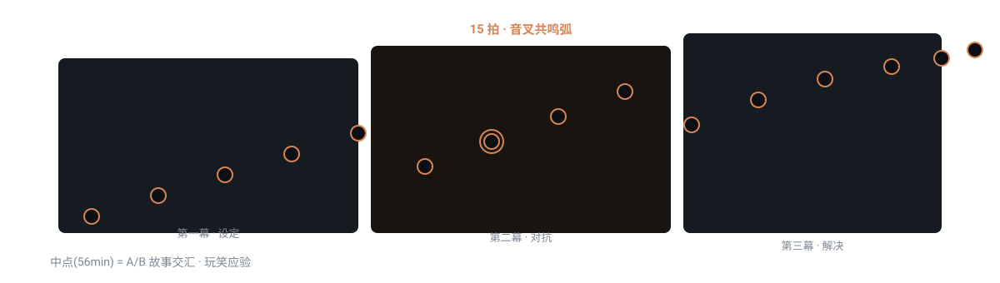

# domn-film-screenplay-save-the-cat


> 基于布莱克·斯奈德《救猫咪》体系，把一句话故事提案匹配到 10 大题材、套 15 拍结构表推演出可写作的节拍表与大纲。

## 真实产出样例

下面是这个技能**实际会产出**的东西（抽自仓库内的 references/ 真实交付样例），不是抽象描述：

```text
题材判定：鬼怪屋型（怪物 Alien ＋ 封闭飞船"房子" ＋ 公司贪婪之"罪"）
- 中点(56min)：晚饭时异形炸开约翰的胸部溜出来，就发生在帕克说过
  "你像死了一样"的地点——玩笑应验了，"游戏"结束。A 故事与 B 故事交汇。
- 一无所有：雷普利从"母亲"处得知公司明知异形是杀手仍派船——公司之
  "罪"被揭露；半人告诉她将丧命："死亡的气息"。
- 终场画面：一个幸存者和一只猫终于入睡。
```

## 是什么

基于布莱克·斯奈德《救猫咪》体系，把一句话故事提案匹配到 10 大题材、套 15 拍结构表推演出可写作的节拍表与大纲。 本仓库是一个 Agent 技能（SKILL.md 为唯一权威定义），把上面的方法论沉淀为可被对话触发的可执行流程。

## 为什么不同

「先用题材定性、再用 15 拍定量、最后从同类片库推演」——用分岔问题先砍掉一半题材，底层信条是「静止=死亡」与「每一拍都是一次音叉共鸣」。

## 怎么做（工作流）

<p align="center">
  
</p>

> 静止=死亡；每一拍都是一次音叉共鸣

1. **抽 6 信号** — 从提案里抽出类型/基调/主角/代价/反转/母题六信号
2. **科幻塌架测试** — 若涉科幻，跑塌架测试剔除伪设定
3. **匹配题材** — 10 大题材里定位主类型，砍掉错配
4. **套 15 拍** — 把故事推演进 15 节拍表
5. **同类片校验** — 用 50 部影片拆解语料交叉验证

## 怎么用

将本仓库放入支持 `SKILL.md` 的 Agent 技能目录：

- **WorkBuddy**：`~/.workbuddy/skills/domn-film-screenplay-save-the-cat/`
- **Codex / 其他**：对应 skills 目录

然后在对话中触发，例如：

```
用 domn-film-screenplay-save-the-cat 把'一个程序员发现老板其实是 AI'写成一句话 logline 并拆 15 拍。
```

## 依赖

纯提示词方法论 + references/ 弹药库；生视频依赖文生视频模型（即梦 Seedance / Kling / 可灵等），提示词喂给这些模型执行。

## 仓库结构

```
domn-film-screenplay-save-the-cat/
├── SKILL.md                 # 技能定义（唯一权威）
├── assets/                  # 模板 / 占位素材
├── references/              # 方法论弹药库
└── assets/readme/           # 本 README 的视觉资产（hero.webp / workflow.svg）
```

## 许可

本仓库内容以 `SKILL.md` 为唯一权威定义。如附带 `LICENSE` 文件，以其为准。

---

*README 由 `beautify-github-readme` 生成 · 封面图来自作者作品集，强调色由封面采样派生；工作流图为每技能独立 motif。*